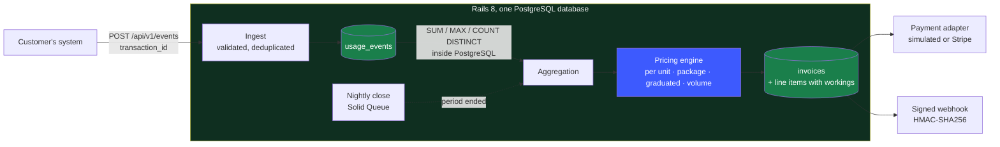

# sw-rails-usage-billing

**Meterly** is a usage-based billing engine: it takes a firehose of metered
events, works out what each customer owes for the period and issues the
invoice.

Billing per seat is arithmetic. Billing per unit of usage is where the money
quietly leaks: the same event arrives twice after a retry, a tier is applied to
the wrong slice of the quantity, a nightly job runs twice and bills the customer
twice, half a penny is rounded away on every one of forty lines.

Meterly is built so those things cannot happen and so the invoice can always
explain itself.



Two rules do most of the work:

1. **The database decides what is unique.** `usage_events` has a unique index on
   `(organization_id, transaction_id)` and `invoices` has one on
   `(subscription_id, period_start)`. A client that replays a batch, or a worker
   that picks up the same subscription twice, cannot produce a second charge.
   [There is a test for exactly that.](spec/services/billing/generate_invoice_spec.rb)
2. **Money is integer cents, rounded once.** Every intermediate value is a
   `BigDecimal` in cents, including sub-penny unit prices such as £0.0005 per
   request and the rounding happens at the end of a line rather than at the end
   of a tier.

---

## Run it

One command. It builds the images, starts PostgreSQL, the web process and a job
worker, runs the test suite and the end to end check against the running stack,
then takes it all down again.

```bash
bin/verify
```

To sit and click about instead:

```bash
docker compose up
```

Then open <http://localhost:3000> and sign in as `demo@meterly.test` with
`password123`. The seed builds an organization that has been trading for 45
days, so there is a closed period that has already been invoiced and a period
still running with a live usage total.

Nothing outside Docker is needed. No Ruby, no Node, no Redis.

---

## What it does

| | |
|---|---|
| **Metering** | Ingest API with idempotency keys, batch endpoint, per-key rate limiting, four aggregations: count, sum, max and unique count, with property filters such as `region in eu-west-1` |
| **Pricing** | Four charge models: per unit, package, graduated tiers and volume tiers, each with a free allowance, plus a recurring fee and a minimum spend commitment |
| **Invoicing** | Anchored billing periods, proration when a subscription is terminated mid-period, VAT per customer, gapless per-organization invoice numbers, line items that carry their own workings |
| **Money out** | Payment collection behind an adapter: a deterministic simulated gateway by default and a Stripe gateway on the official `stripe` gem, exercised in CI against `stripe-mock` (no live Stripe account is used). Signed inbound Stripe webhooks and outbound webhooks signed with HMAC-SHA256 and retried with exponential backoff |
| **Operating it** | A dashboard for customers, plans, invoices and raw events, API keys that are shown once and stored as digests and a nightly billing run on Solid Queue |

## The pricing engine

A charge joins a plan to a metric and says how the quantity becomes money.
Given 12,000 units, the four models behave differently on purpose:

| Model | Configuration | Result |
|---|---|---|
| Per unit | 0.05c each, first 1,000 free | 11,000 × 0.05c = **550c** |
| Package | 500c per 1,000 units | ⌈12,000 / 1,000⌉ × 500c = **6,000c** |
| Graduated | 0.5c up to 10,000, then 0.3c | 10,000 × 0.5c + 2,000 × 0.3c = **5,600c** |
| Volume | 12c up to 1,000, 9c up to 10,000, then 6c | 12,000 × 6c = **72,000c** |

Graduated pricing slices the quantity the way income tax brackets work. Volume
pricing puts every unit on the rate the total reached, so buying more can make
the whole bill cheaper, which is the point of it.

Each result carries a breakdown and that breakdown is stored on the invoice
line. An invoice raised in 2026 still shows the tier boundaries and rates it was
raised under, long after the price list has moved on.

## The parts that are easy to get wrong

**Billing periods are anchored to the subscription start, not to the calendar.**
A subscription that starts on 31 January bills on 28 February, then on 31 March.
Every boundary is computed from the anchor rather than from the previous
boundary, so the anchor never drifts to the 28th for good.

**Invoice numbers are gapless per organization and year.** The sequence is read
and written inside a transaction-scoped PostgreSQL advisory lock, so two workers
finalising at the same instant cannot both take `00007`.

**Aggregation happens in PostgreSQL.** A busy period holds millions of events
and none of them need to travel to Ruby. A property that is not a number is
skipped rather than failing the run, because bad data from one client should not
stop the billing of everyone else.

**Terminating mid-period prorates the fee.** The period is cut at the
termination, the recurring fee and any minimum commitment are scaled by the
fraction of the period that was served and only the usage inside the shortened
window is billed.

## The API

Machine traffic authenticates with a bearer token. The key is generated once and
stored as a SHA-256 digest, so verification is a single indexed lookup rather
than a table scan of bcrypt comparisons.

```bash
curl -X POST http://localhost:3000/api/v1/events \
  -H "Authorization: Bearer $METERLY_API_KEY" \
  -H "Content-Type: application/json" \
  -d '{"event": {
        "transaction_id": "req-2026-08-22-0001",
        "external_subscription_id": "sub_cus_bramble",
        "code": "api_requests",
        "timestamp": "2026-08-22T09:15:00Z",
        "properties": {"requests": "1200", "region": "eu-west-1"}
      }}'
```

Send it again with the same `transaction_id` and the answer is
`{"status": "duplicate"}` with a 200, not a second charge.

| Method | Path | Purpose |
|---|---|---|
| `POST` | `/api/v1/events` | Ingest one event |
| `POST` | `/api/v1/events/batch` | Ingest up to 500, reported on individually |
| `GET` | `/api/v1/subscriptions/:external_id/current_usage` | What the open period would cost if it closed now |
| `POST` | `/api/v1/subscriptions/:external_id/terminate` | End a subscription and prorate the final period |
| `GET` | `/api/v1/invoices/:number` | An invoice with its line items and workings |

The full reference, including customers, plans and webhook payloads, is in
[docs/api.md](docs/api.md).

## Sending usage from other services

Any service that does metered work reports it the same way: one event per unit
of work, keyed by an id the service already has, so a retry is free. None of
the sibling portfolio repositories is wired up to Meterly yet; this is how each
of them would be.

**One-time setup, per service.** The catalogue has no API yet, so the metric
and plan are created in a seed or the Rails console. Customers and
subscriptions do have an API, so the calling service can provision its own
tenants.

```ruby
# bin/rails runner, once
org = Organization.find_by!(slug: "acme")
tokens = org.billable_metrics.create!(code: "llm_tokens", name: "LLM tokens",
                                      aggregation_type: "sum", property_name: "tokens")
plan = org.plans.create!(code: "llm_pay_as_you_go", name: "LLM pay as you go", currency: "GBP")
# 0.002p a token for the first million in the period, then 0.001p
plan.charges.create!(billable_metric: tokens, pricing_model: "tiered",
                     properties: { "tiers" => [ { "up_to" => 1_000_000, "unit_amount_cents" => "0.002" },
                                                { "up_to" => nil, "unit_amount_cents" => "0.001" } ] })
```

**Token counts from the LLM serving repositories.** The inference server
already knows the request id and the prompt and completion token counts the
model reported. After each response it posts them as one `sum` event:

```python
import os
import httpx

METERLY_URL = os.environ["METERLY_URL"]          # e.g. http://meterly:3000
METERLY_API_KEY = os.environ["METERLY_API_KEY"]  # an mtr_sk_ key from Settings

def report_tokens(subscription_id: str, request_id: str, usage: dict, model: str) -> None:
    event = {
        "transaction_id": f"llm-{request_id}",        # the idempotency key
        "external_subscription_id": subscription_id,  # one per tenant or API key
        "code": "llm_tokens",
        "properties": {
            "tokens": usage["prompt_tokens"] + usage["completion_tokens"],
            "model": model,
        },
    }
    response = httpx.post(f"{METERLY_URL}/api/v1/events", json={"event": event},
                          headers={"Authorization": f"Bearer {METERLY_API_KEY}"}, timeout=5)
    response.raise_for_status()  # 201 accepted, 200 duplicate, 422 says why it was rejected
```

A `model` property lets a second metric with a filter such as
`{"model": ["llama-3-8b-ft"]}` price one model differently from another.

**High-volume senders** should buffer and flush through
`POST /api/v1/events/batch` (up to 500 events a request, reported on one by
one) rather than one request per event, because each API key is rate limited to
600 requests a minute. Re-sending a whole batch after a timeout is safe: rows
already stored come back as `duplicate`.

| Sibling service | Metric | Aggregation | Transaction id |
|---|---|---|---|
| ml-domain-llm-finetune-serve | `llm_tokens`, property `tokens` | `sum` | the inference request id |
| sw-saas-platform | `api_requests` | `count` | the request id |
| sw-iot-telemetry-platform | `ingested_gb`, property `gigabytes` | `sum` | device id plus message sequence number |
| sw-n8n-opportunity-radar | `scored_notices` | `count` | the notice id |

In the other direction, a service that needs to react to billing subscribes a
webhook endpoint to `invoice.finalized`, `invoice.paid` and
`invoice.payment_failed` and verifies `X-Meterly-Signature` as described in
[docs/api.md](docs/api.md#webhooks).

## Collecting through Stripe

`PAYMENT_PROVIDER=stripe` swaps the simulated gateway for
[`Payments::StripeGateway`](app/services/payments/stripe_gateway.rb), built on
the official `stripe` gem (20.x, API version `2026-09-30.endive`). Meterly stays
the rating engine: when an invoice is charged, it is mirrored into Stripe as one
invoice item per Meterly line plus the tax, then finalised and paid. Stripe
never re-rates the usage, so the two totals cannot drift and the gateway
refuses to send an invoice whose lines do not add up to its total.

| | |
|---|---|
| **Customers** | Created on first charge and remembered in `provider_references`, so the billing tables carry no Stripe columns |
| **Metered prices** | `bin/rails "stripe:sync_catalogue[acme]"` publishes a Product per plan, a Billing Meter per metric and a metered Price per charge, translating per unit, graduated, volume and package pricing. Charges Stripe cannot express exactly are skipped with the reason |
| **Meter events** | With `STRIPE_MIRROR_USAGE=true`, each newly accepted event is copied to its meter, identified by its transaction id so Stripe deduplicates replays too |
| **Invoices** | Created, itemised, finalised and paid with idempotency keys derived from Meterly ids, so a retried job cannot charge twice. A declined card is a failed attempt; an outage is retried with backoff |
| **Webhooks** | `POST /webhooks/stripe` verifies `Stripe-Signature` with the gem and applies `invoice.paid` and `invoice.payment_failed`, each at most once |

| Variable | Meaning |
|---|---|
| `STRIPE_API_KEY` | A secret key. In CI it is a throwaway `sk_test_` value generated for the run |
| `STRIPE_API_BASE` | Optional. Points the client at `stripe-mock` instead of `api.stripe.com` |
| `STRIPE_WEBHOOK_SECRET` | The endpoint's signing secret. In CI and the specs it is generated for the run, never committed |
| `STRIPE_MIRROR_USAGE` | `true` to copy usage events to Stripe meters |

**What is simulated.** CI runs the gateway against
[stripe-mock](https://github.com/stripe/stripe-mock) `v0.206.0`, Stripe's own
emulator, as a service container. It validates every request against Stripe's
API specification but is stateless, never declines a card and never sends
webhooks, so those paths are tested by raising the gem's own errors at the
client and by signing events in the test. Nothing has been run against a Stripe
account, in test mode or live. See [docs/limitations.md](docs/limitations.md).

To run the Stripe specs locally:

```bash
docker run --rm -p 12111:12111 stripe/stripe-mock:v0.206.0
STRIPE_MOCK_URL=http://localhost:12111 bundle exec rspec spec/services/payments
```

## Tests

188 examples and the ones worth reading are the arithmetic:

```bash
bin/verify                                        # everything, in Docker
docker compose exec -e RAILS_ENV=test web bundle exec rspec
```

| Area | What is proved |
|---|---|
| [Pricing models](spec/services/billing/pricing_models_spec.rb) | Tier boundaries, part-used packages, sub-penny rounding, invalid price lists |
| [Billing periods](spec/services/billing/billing_period_spec.rb) | Month-end anchors, leap years, part periods after a termination |
| [Aggregation](spec/services/billing/aggregator_spec.rb) | Window edges, filters, non-numeric properties, other tenants' events |
| [Invoicing](spec/services/billing/generate_invoice_spec.rb) | Idempotency, a lost race, a rolled back write |
| [Ingest](spec/services/events/ingest_spec.rb) | Replays, unknown subscriptions, clock skew, epoch timestamps |
| [Webhooks](spec/services/webhooks/signature_spec.rb) | Signature verification, altered payloads, replays outside the tolerance |
| [Stripe gateway](spec/services/payments/stripe_gateway_spec.rb) | Customers, catalogue, meter events and invoices through the official gem against stripe-mock; idempotent retries, declines, outages |
| [Stripe pricing](spec/services/payments/stripe_catalogue_spec.rb) | Each Meterly pricing model translated to a Stripe price and the shapes refused |
| [Stripe webhooks](spec/requests/stripe_webhooks_spec.rb) | Signatures from a runtime secret, forged and altered bodies, stale timestamps, redelivery |

### The end to end check

`bin/e2e` is not a unit test. It provisions a throwaway organization, sends 125
events over HTTP, replays one, quotes the open period, closes the finished
period through the real Solid Queue worker, reads the invoice back over the API
and asserts the totals to the penny, then waits for the application to receive
its own signed webhook and verify it. Nothing in the application is stubbed.

In CI the worker collects through the Stripe gateway against stripe-mock and
the check then posts a correctly signed and a forged Stripe event to
`/webhooks/stripe`, expecting a 200 and a 400.

```
 6. Quote the period that is still running
    ok    quoted subtotal: 10005
 8. Read the invoice back over the API
    ok    invoice subtotal: 10578
    ok    invoice VAT: 2116
    ok    invoice total: 12694
 9. Confirm the invoice was collected
    ok    collected by: stripe
10. Confirm the signed webhook arrived
    ok    webhook signature verified: true
11. Send signed and forged Stripe webhooks to the receiver
    ok    signed event status: 200
    ok    forged event status: 400
```

## CI

[](https://github.com/CGainsWorks/sw-rails-usage-billing/actions/workflows/ci.yml)

[One job on one runner](.github/workflows/ci.yml) does the lot on every push:
RuboCop (`rubocop-rails-omakase`), Brakeman, bundler-audit and an importmap
audit, RSpec against PostgreSQL and stripe-mock service containers, then the end
to end check against a booted web process and job worker collecting through the
Stripe gateway. Bundler runs frozen, so a Gemfile change without its
`Gemfile.lock` fails the build and Ruby is installed from `.ruby-version`, the
same patch release as the production image. Running those as
five parallel jobs would pay for five checkouts and five bundle installs to save
about a minute of wall clock, which is the wrong trade on a monthly minute
budget.

The rest is kept cheap on purpose: a newer push cancels the run it supersedes,
documentation-only commits are skipped, every job carries a `timeout-minutes` so
a hung run cannot drain the budget, the runner image is pinned rather than
floating on `ubuntu-latest` and [the production image](.github/workflows/image.yml)
is built only when the `Dockerfile` or the gems actually change.

Locally, `bin/ci` runs the static checks and the suite. `bin/verify` adds the end
to end check.

## Design notes

**One database, no Redis.** Background jobs run on Solid Queue and the cache is
Solid Cache, both in the same PostgreSQL database as the billing data. A
deployment is one database server and one process type and a job that enqueues
work inside a transaction cannot be picked up before that transaction commits.

**Services, not fat models.** The domain lives in `app/services/billing`, which
is where an auditor would look: `BillingPeriod`, `Aggregator`, `PricingModels`,
`PeriodStatement`, `GenerateInvoice`, `FinalizeInvoice`. `PeriodStatement` is
the single source of truth for what a period costs, so the mid-month quote in
the dashboard and the invoice at the end of the month cannot disagree.

**Read the architecture** in [docs/architecture.md](docs/architecture.md) and
what is deliberately left out in [docs/limitations.md](docs/limitations.md).

## Stack

Ruby 3.3, Rails 8.1, PostgreSQL 16, Solid Queue, Solid Cache, Hotwire, Propshaft,
the `stripe` gem, RSpec, stripe-mock, Docker. No JavaScript build step and no CSS
framework.

Current state, what is simulated and what is left: [STATUS.md](STATUS.md).
