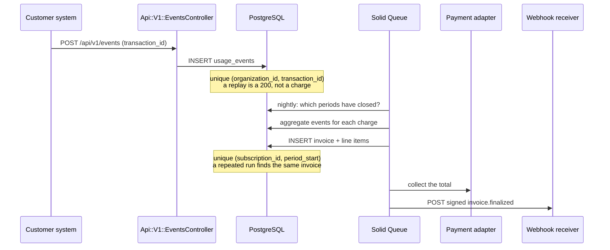
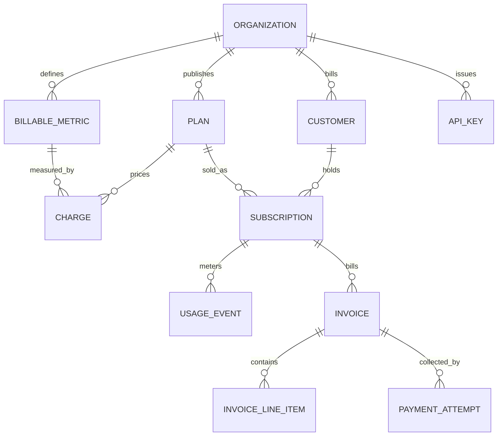

# Architecture

Meterly turns metered events into invoices. This document explains the moving
parts, the data model and the decisions that would be expensive to change later.

## The pipeline

## Data model

An **organization** is the company using Meterly, not the company being billed.
Everything else hangs off it and every query in the application is scoped
through it, so one tenant cannot read another's rows even when an id is guessed.

A **billable metric** says what is counted and how: `count` of events, `sum` or
`max` of a property, or `unique_count` of distinct property values, optionally
filtered to events whose properties match, such as `region in eu-west-1`.

A **charge** joins a plan to a metric and adds a pricing model with its
properties. A **plan** adds the recurring fee, the billing interval and an
optional minimum spend.

A **usage event** is one metered fact with a client-supplied `transaction_id`, a
timestamp and a JSONB property bag.

## Where the domain lives

| Object | Responsibility |
|---|---|
| `Billing::BillingPeriod` | Period boundaries from the subscription anchor, closed periods, proration fraction |
| `Billing::Aggregator` | One metric over one period, aggregated inside PostgreSQL |
| `Billing::PricingModels::*` | Quantity to cents, plus a breakdown that explains the arithmetic |
| `Billing::ChargeCalculator` | One charge for one period: aggregate then price |
| `Billing::PeriodStatement` | Everything a period costs: fee, usage lines, minimum true-up, VAT |
| `Billing::GenerateInvoice` | Persists a statement as a draft invoice, idempotently |
| `Billing::FinalizeInvoice` | Numbering under an advisory lock, then webhook and collection |
| `Events::Ingest` | Validation, subscription resolution, deduplication |
| `Webhooks::*` | Signing, delivery, backoff |
| `Payments::*` | Gateway adapters (simulated and Stripe), the Stripe catalogue translation, the Stripe webhook handler and the record of each attempt |

`PeriodStatement` is deliberately the only place that knows what a period costs.
The dashboard preview, the `current_usage` API and the invoice all render the
same object, so a customer cannot be quoted one number mid-month and billed
another at the end of it.

## Decisions

**Amounts are integer cents in the database and BigDecimal cents in memory.**
Unit prices are frequently fractions of a cent, so the calculation carries
decimals and rounds half up once per line. Rounding per tier would lose or gain
half a penny on every tier of every line of every invoice.

**Periods are anchored to `subscription.started_at`.** Boundaries are computed
as `anchor.advance(months: n)`, which clamps 31 January to 28 February and then
returns to 31 March, because each boundary is derived from the anchor rather
than from the previous boundary.

**Idempotency is enforced by unique indexes, not by application checks.** An
application check has a race between the read and the write. The index does not.
Both `Events::Ingest` and `Billing::GenerateInvoice` do the cheap lookup first
and then treat the constraint violation as the authoritative answer.

**Invoice numbering takes `pg_advisory_xact_lock(organization_id, year)`.** The
sequence has to be gapless per organization for accounting, which a plain
`COUNT + 1` cannot promise under concurrency. The lock is transaction-scoped, so
it is released whatever happens next.

**Jobs are small and idempotent.** The nightly job only enqueues work, one job
per subscription and period, so a single awkward subscription cannot hold up the
run and a retry cannot double bill.

**Webhook retries live in the database, not in the job backend.** A failed
delivery is left `pending` with a `deliver_after` in the future and a recurring
job sweeps for due deliveries. A receiver that is down for an hour costs one row
per event rather than one retrying job per event.

**API keys are SHA-256 digests, not bcrypt.** A key arrives on every ingest
request, so verification has to be one indexed lookup. The token has 190 bits of
entropy from a CSPRNG, so it does not need stretching against dictionary attacks
the way a human-chosen password would.

## Failure behaviour

| Failure | What happens |
|---|---|
| Client replays a batch | Every event answers `duplicate`, nothing is billed twice |
| Two workers close the same period | One invoice is written, the loser reads it back |
| A property is not a number | That event is skipped, the rest of the period bills normally |
| Payment declines | The invoice stays `finalized`, the attempt is recorded, `invoice.payment_failed` is sent |
| Stripe is unreachable or rate limiting | The charge job retries with backoff, replaying the same idempotency keys, so the card is charged at most once |
| Stripe redelivers a webhook | `invoice.paid` finds the invoice already paid; a failure is recorded once per Stripe event id |
| Webhook receiver is down | Backoff of 30s, 1m, 2m, 4m, 8m, then the delivery is marked `failed` |
| Invoice line fails validation | The whole invoice rolls back, nothing half written is left |
